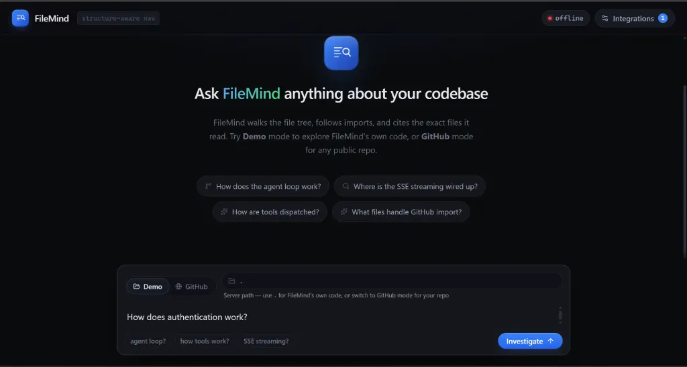

<h2 align="center">Turning curiosity into working software ✨</h2>

  Currently doing my <b>B.Tech in Computer Science & Engineering</b> at <b>REVA University</b> 🎓

### stack

  
  
  
  
  
  
  
  
  
  
  
  
  
  
  
  
  
  
  
  
  
  
  
  
  
  

  
  🏆 <b>FileMind — featured in the winners list</b> <i>(Botathon 2026)</i>  
  A codebase investigation agent that explores code the way a curious engineer would — 
  it walks the file tree, follows the imports, and points you to the exact files it read. 
  Works on your local project or any public GitHub repo.  
  <a href="https://botathon-nine.vercel.app/"><b>🔗 Try it live</b></a> &nbsp;·&nbsp;
  <a href="https://github.com/Shashank-U-04/botathon"><b>💻 Peek at the code</b></a>

 

### find me

github → [Shashank-U-04](https://github.com/Shashank-U-04) &nbsp; linkedin → [/in/shashank-u-016b54330](https://www.linkedin.com/in/shashank-u-016b54330/) &nbsp; email → [shashank.u.shashu1359@gmail.com](mailto:shashank.u.shashu1359@gmail.com)
