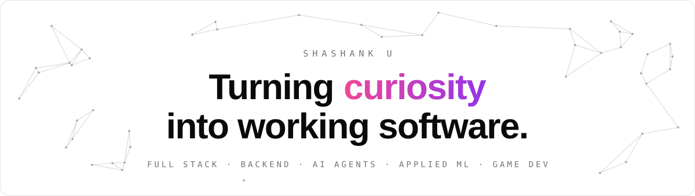
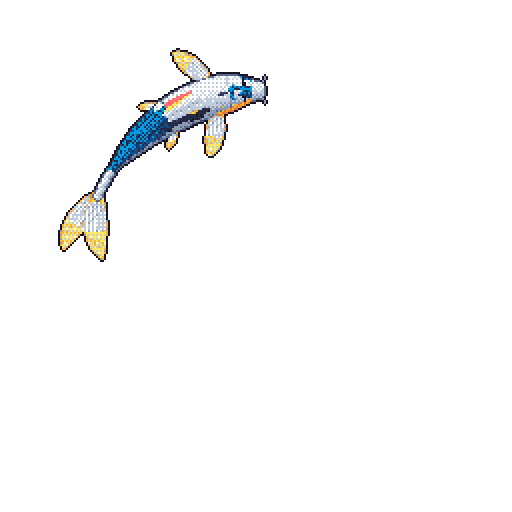

<picture>
  <source media="(prefers-color-scheme: dark)" srcset="assets/hero-dark.svg"/>
  
</picture>

  
  
  

  CSE student building software that solves real problems, from the browser to the backend.

### Honors

🏆 **Botathon 2026 · Winner**, Apify & SuperPlane tracks 
**FileMind**, an agent that explores codebases like a developer and cites every file it read. [Live](https://botathon-nine.vercel.app/) · [Code](https://github.com/Shashank-U-04/botathon)

🥈 **HackFest 2026 · Runner-up**, AI Nexus track 
**Sketchy**, a forensic sketch workspace. I built the backend, the image-generation server and bloodstain analysis. [Blog](https://shashanku.vercel.app/blog/sketchy-hackfest-2026)

### Tools

  
  
  
  
  
  
  
  

  
  
  
  
  
  

  
  
  
  
  
  
  
  

  <picture>
    <source media="(prefers-color-scheme: dark)" srcset="https://github-profile-summary-cards.vercel.app/api/cards/repos-per-language?username=Shashank-U-04&theme=github_dark"/>
    
  </picture>
  

### Connect

