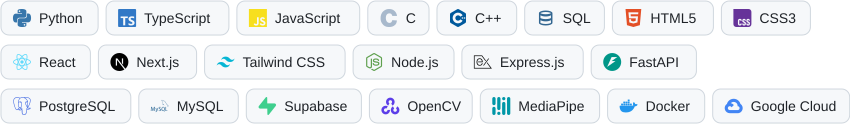
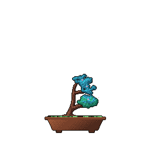

<picture>
  <source media="(prefers-color-scheme: dark)" srcset="assets/banner-dark.svg"/>
  
</picture>

  
  
  

  CSE student building software that solves real problems, from the browser to the backend.

### Honors

🏆 **Botathon 2026 · Winner**, Apify & SuperPlane tracks 
**FileMind**, an agent that explores codebases like a developer and cites every file it read. [Live](https://botathon-nine.vercel.app/) · [Code](https://github.com/Shashank-U-04/botathon)

🥈 **HackFest 2026 · Runner-up**, AI Nexus track 
**Sketchy**, a forensic sketch workspace. I built the backend, the image-generation server and bloodstain analysis. [Blog](https://shashanku.vercel.app/blog/sketchy-hackfest-2026)

### Tools

<picture>
  <source media="(prefers-color-scheme: dark)" srcset="assets/tools-dark.svg"/>
  
</picture>

 

<table>
  <tr>
    <td align="center" width="50%">
       
      my bonsai · <a href="https://github.com/egorthinks/git-bonsai">git-bonsai</a>
    </td>
    <td align="center" width="50%">
       
      my koi · <a href="https://github.com/yalongwastaken/git-koi">git-koi</a>
    </td>
  </tr>
</table>

🎮 **Currently building** [Doodle Shooter](https://doodle-shooter.vercel.app), a doodle-style shooter game 
♟️🎵 **Off the keyboard**: chess and music

### Connect

  
  
  
  

